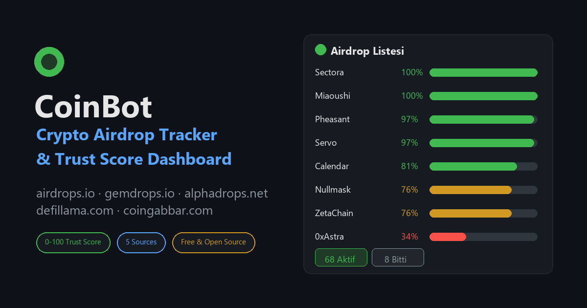

<div align="center">



# CoinBot — Crypto Airdrop Tracker & Trust Score Dashboard

[](https://www.python.org/)
[](https://flask.palletsprojects.com/)
[](LICENSE)
[](#-kurulum)

**English:** CoinBot is an open-source crypto airdrop tracker. It scans airdrop
listing sites every 30 minutes, scrapes each drop's detail page (reward, exchange,
contract address, steps) and scores every coin with a transparent factor-based
**0–100 trust score** — shown on a live local dashboard.

**Türkçe:** CoinBot, kripto airdrop sitelerini otomatik tarayan, her drop'un detay
sayfasına girip (ödül, borsa, kontrat, adımlar) veri çıkaran ve her coine şeffaf
faktör bazlı **%0-100 güven puanı** veren açık kaynak bir airdrop tarayıcıdır.

[Özellikler](#-özellikler) · [Kurulum](#-kurulum) · [Güven Puanı](#-güven-puanı-0--100) · [Kaynaklar](#-izlenen-kaynaklar) · [FAQ](#-sık-sorulan-sorular)

</div>

## ✨ Özellikler

- 🔎 **Otomatik tarama** — 5 airdrop kaynağını 30 dakikada bir tarar (`SCAN_INTERVAL_SECONDS`)
- 🪂 **Derin detay çıkarımı** — her coinin detay sayfasından: başlık, reward miktarı
  ("350 USDT" gibi), geçerli borsa (Binance, Bybit, KuCoin, Gate.io, MEXC... 20+ borsa),
  katılım adımları, `0x...` kontrat adresi, sosyal medya linkleri
- 🚦 **Durum takibi** — her drop Aktif / Bitmiş olarak işaretlenir, panelde filtrelenir
- 📊 **Güven puanı** — faktör bazlı %0-100 puan + kategori: Güvenilir / Kısmen /
  Az Güvenilir / Riskli
- 🖥️ **Canlı dashboard** — puan sıralaması, durum/kaynak/kategori filtreleri, arama,
  otomatik yenileme, `/api/coins` JSON API
- 🧩 **Kolay kaynak ekleme** — yeni bir site tek `config.py` satırıyla tanıtılır
- ⚠️ **Risk uyarıları** — ücret isteyen ("paid") projeler otomatik ceza alır ve
  panelde "ÜCRET İSTİYOR" etiketiyle işaretlenir

## 🚀 Kurulum

```bash
git clone https://github.com/RetroNyym/coin-airdrop-tracker.git
cd coin-airdrop-tracker
pip install -r requirements.txt
python dashboard.py
```

Windows'ta: `baslat.bat` dosyasına çift tıkla. Panel otomatik açılır:
**http://127.0.0.1:8787**

## 📊 Güven Puanı (%0–100)

| Faktör | Ağırlık | Ne bakılır |
|---|---|---|
| Kontrat paylaşımı | +18 | `0x...` kontrat adresi paylaşılmış mı |
| Borsa bağlantısı | +16 | bilinen hangi borsalarla anılıyor |
| Detay netliği | +15 | net reward + katılım adımları |
| Sosyal aktivite | +14 | twitter/telegram/discord linkleri |
| Audit / KYC | +12 | denetim geçmişi belirtilmiş mi |
| Şeffaflık | +10 | adım adım talimat netliği |
| Güncellik | +10 | temel puandır |
| **ÜCRET İSTİYORSA** | **−25** | "deposit required / buy to claim" |

Kategori eşikleri: **Güvenilir (%75+)** · **Kısmen Güvenilir (%55–74)** ·
**Az Güvenilir (%35–54)** · **Riskli (<%35)**

Ağırlıkları `config.py → WEIGHTS` üzerinden değiştirebilirsin — puanlama mantığı
tamamen şeffaf ve özelleştirilebilir.

## 🌐 İzlenen Kaynaklar

| Kaynak | İçerik |
|---|---|
| airdrops.io | latest + hot listeleri, expired arşiv |
| gemdrops.io | aktif airdrop / proje kartları |
| alphadrops.net | geniş airdrop kataloğu |
| defillama.com | protokol airdrop panosu |
| coingabbar.com | tablo bazlı liste (reward + tarih) |

### Yeni kaynak ekleme

`config.py → SOURCES` içine ekle:

```python
"yenisite.com": {
    "list_urls": ["https://yenisite.com/latest/"],
    "link_selector": "a[href]",
    "path_pattern": r"^/airdrop/[a-z0-9-]+/?$",  # detay sayfa deseni
    "exclude": ["about", "contact"],
    "domain": "https://yenisite.com",
},
```

## 🗂️ Proje Yapısı

```
dashboard.py   → ana uygulama: tarama döngüsü + web paneli
scrapers.py    → çok kaynaklı airdrop kazıyıcı (detay sayfaları dahil)
scoring.py     → faktör bazlı güven puanı motoru
database.py    → SQLite katmanı (coinbot.db)
fetcher.py     → gecikmeli + temiz HTTP yardımcısı
config.py      → tüm ayarlar (kaynaklar, ağırlıklar, aralık)
templates/     → dashboard sayfaları (panel, airdrop listesi, detay)
docs/          → GitHub Pages tanıtım sitesi
```

## ❓ Sık Sorulan Sorular

**Bu puan yatırım tavsiyesi mi?**
Hayır. Puanlar sayfa verisinden hesaplanan otomatik tahmindir; cüzdanını bağlamadan
veya hiçbir para göndermeden önce kendi araştırmanı yap (DYOR).

**Hangi borsalar algılanıyor?**
Binance, Bybit, OKX, KuCoin, Gate.io, MEXC, Bitget, Kraken, Coinbase, HTX,
Bitfinex, Poloniex, LBank, Upbit ve diğerleri (listeyi `scrapers.py → EXCHANGES`
içinde genletebilirsin).

**Ücretli "airdrop"lara ne oluyor?**
"Aloka için para yatır / satın al" talep eden projeler −25 puan ceza alır ve
panelde kırmızı **ÜCRET İSTİYOR** etiketiyle görünür. Bu desen klasik dolandırıcılık
işaretidir.

**Panel herkese açık mı?**
Hayır — dashboard yalnızca `127.0.0.1` (senin bilgisayarın) üzerinde çalışır.
Veri tabanı da `.gitignore` sayesinde GitHub'a gönderilmez.

## 📄 Lisans

MIT — detaylar için [LICENSE](LICENSE).

---

<div align="center">

**Airdrop avına çıkmadan önce akıllı sıralama.** ⭐ Beğendiysen repo'ya yıldız ver!

</div>
